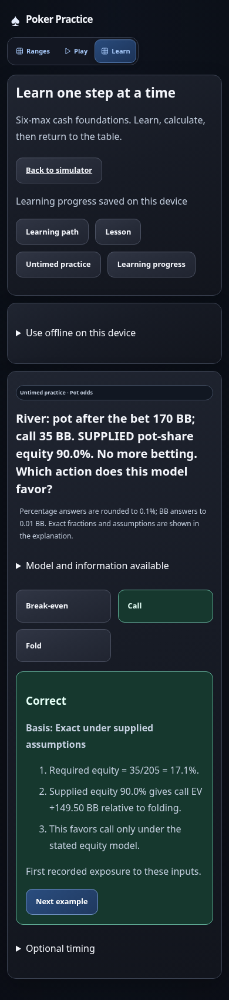

# Fundamentals: actual app

The production app in Chromium at a 390-pixel viewport, with reduced motion enabled. This is a captured practice screen, not a concept rendering. The green answer/explanation indicates a mathematically correct choice under the displayed supplied equity assumption.

Actual iPhone/Safari behavior and VoiceOver remain unverified. The screen shows a terminal river exercise; this is not a solver evaluation of a live simulator mistake.
