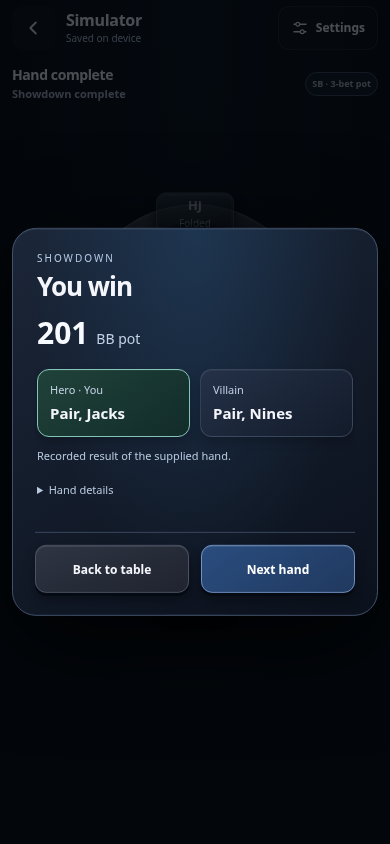
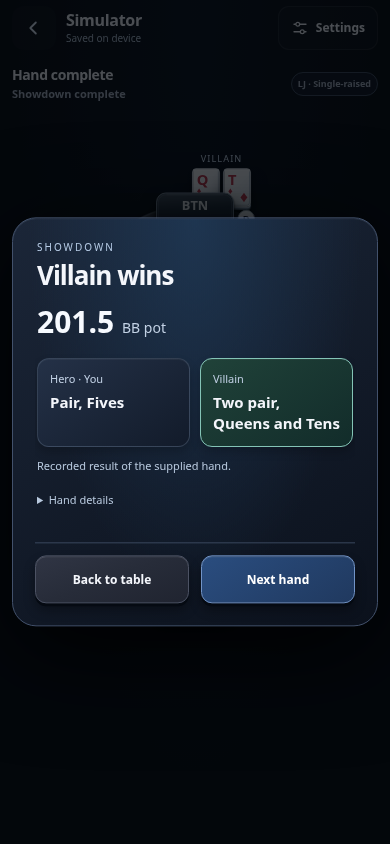
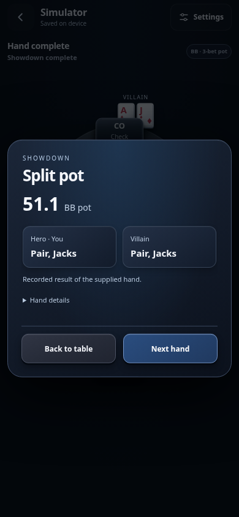

# Implemented showdown outcomes

Actual production-app Chromium captures at 390 × 844. These are implementation evidence, not generated concepts or a claim of iPhone testing. Existing recorded hands supply all winners, pots and hand names.

See [material depth and outcome verification](../../implementation/MATERIAL_DEPTH_OUTCOMES.md). The current implementation also deepens the table, rail, seats, cards and action buttons; those effects should be checked directly on the device.
