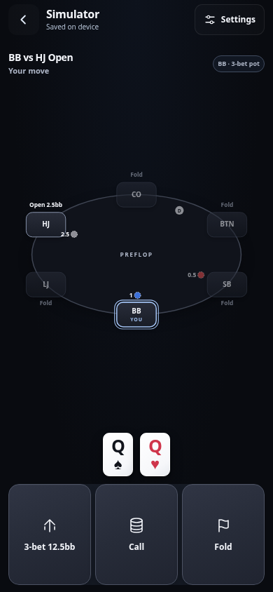
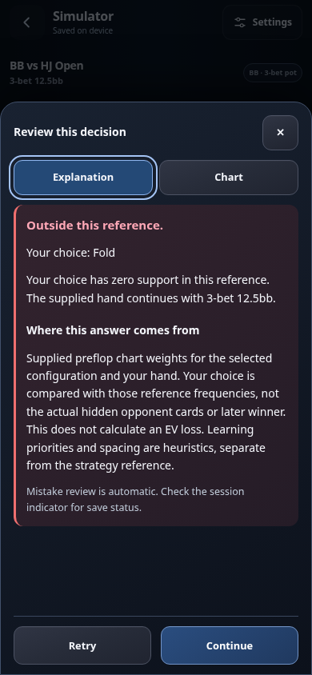
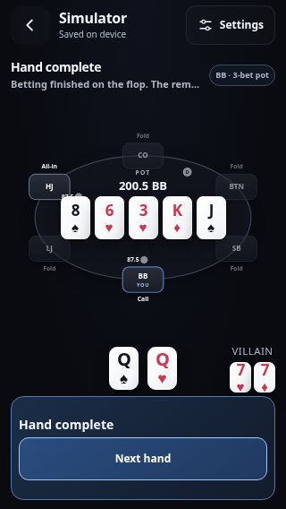

# Actual mobile focus interface

Captured from the production app in headless Chromium, not generated mockups. Phone-sized browser testing does not establish actual iPhone/Safari behavior. Table styling is still the existing design; its visual redesign and the home screen remain separate approval steps.

## Decision — 390 × 844

## Automatic error explanation — 390 × 844

## Final result — 320 × 568

The final-review popup and its reopen action have been removed; the table remains visible with Next hand. In short landscape layouts, the table/cards occupy the left column and action controls occupy the right.

