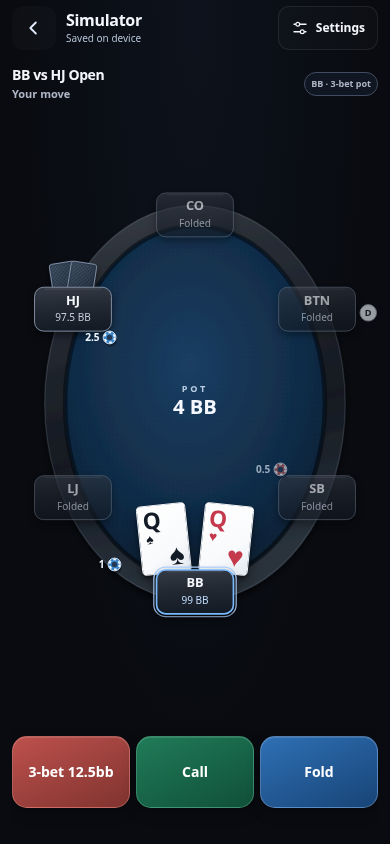
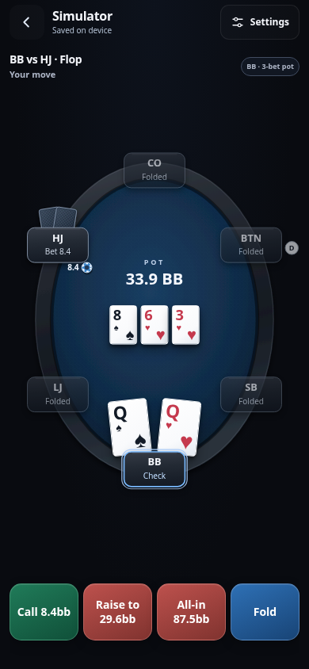
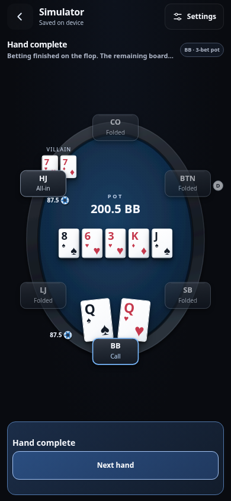
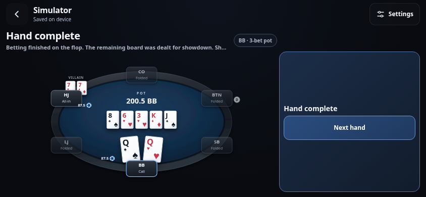

# Option B — actual app

Production Chromium screenshots of the implemented navy table, not generated concepts. Portrait captures are 390 × 844; landscape is 844 × 390. These captures do not establish real iPhone/Safari support.

## Preflop

## Flop

Green identifies Call, not the reference answer. Card faces and public bets come from the existing simulator.

## Showdown

The extra final-review popup stays removed; Next hand remains reachable.

## Landscape

See [implementation, source-state audit and device gates](../../implementation/NAVY_TABLE.md). Home-screen design remains the next separate approval step.
